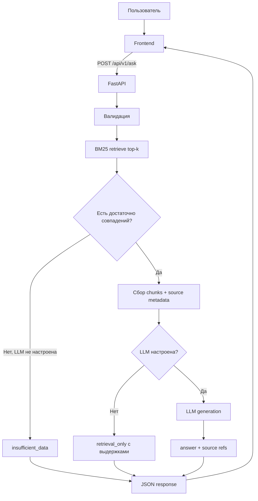

# Обзор архитектуры

**Статус:** реализованный базовый контур приложения; JSONL и SQLite источники поддерживаются конфигурацией; интеграции LLM и Pl@ntNet включаются настройками.

## 1. Технологический стек

- Frontend: существующие `index.html`, `css/style.css`, `js/app.js` (без сборщика).
- Backend: Python + FastAPI, точка входа `backend.app.main:app`.
- Корпус: `DATA_SOURCE=jsonl` → JSONL `data/plants.jsonl`; `DATA_SOURCE=sqlite` → таблицы `plants`, `plant_names`, `categories/plant_categories`, `documents`, `plant_descriptions`, `plant_uses`, `plant_compounds`, `habitats` и `sources`; `plant_images` пока не включена в текстовый поиск.
- Retrieval: самостоятельная реализация BM25 в `backend/app/retrieval.py`.
- RAG/orchestration: `backend/app/service.py`.
- LLM: OpenAI-compatible Chat Completions клиент; поддерживаются Ollama, внешние API, llama.cpp и KoboldCpp.
- Фотоидентификация: опциональный Pl@ntNet API proxy.
- Тесты: pytest + FastAPI TestClient.

## 2. Компоненты и статус

| Компонент | Ответственность | Статус |
|---|---|---|
| Frontend | Чат, загрузка фото, статусы, источники, локальная история | Реализован и подключён к API |
| FastAPI | `/api/v1/*`, валидация, конфигурация, раздача статических файлов | Реализован |
| Corpus loader | JSONL + read-only SQLite loader, проверка ID; XLSX importer в `plants` | Реализован; пользовательские файлы требуют интеграционной проверки |
| Chunker | Разбиение по предложениям с перекрытием | Реализован |
| BM25 | Обратный индекс `термин → chunk → tf`, IDF, нормализация длины, сортировка | Реализован самостоятельно |
| RAG | Первичный retrieve → контекст → LLM → ответ + источники | Реализован; LLM требует настройки |
| Agentic RAG | Ограниченные вызовы поиска/профиля из LLM | Реализован; живой вызов зависит от model tool-calling support |
| Ollama / API / GGUF | Единый OpenAI-compatible интерфейс | Реализован; локальный loopback может работать без API key |
| Photo identify | Загрузка в Pl@ntNet и возврат кандидатов | Реализован опциональный proxy; требует API key |
| Dense/hybrid retrieval | Эмбеддинги и fusion с BM25 | Не реализовано |

## 3. Основной поток RAG

## 4. Agentic RAG

Когда LLM включена, ей передаются первоначальные найденные фрагменты и инструменты `search_plant_knowledge` и `get_plant_profile`. Модель может запросить дополнительные сведения, если текущего контекста недостаточно. Backend сам исполняет только заранее зарегистрированные функции; произвольный SQL, файловая система или произвольные URL недоступны.

Ограничения задаются `AGENT_MAX_TOOL_CALLS` (по умолчанию 5, жёсткий предел 10), `AGENT_MAX_CONTEXT_CHUNKS` (по умолчанию 12) и `MAX_CONTEXT_CHARS` (по умолчанию 24 000; для старых 4K GGUF-моделей рекомендуется снизить примерно до 6 000). Повторные chunks не дублируются. При исчерпании бюджета tools перестают передаваться модели.

Подробности: `agentic-rag.md`. Текущий локальный GGUF setup — `local-gguf.md`.

## 5. Фотоидентификация

Frontend загружает JPEG/PNG в `/api/v1/identify`. Backend проксирует файл в Pl@ntNet и возвращает список вероятных вариантов. Пользователь вручную выбирает растение; выбранное название передаётся в обычный `/ask`. Это внешний идентификатор, а не собственное обучение и не гарантированное определение вида. Подробности: `image-identification.md`.

## 6. Границы достоверности

- Retrieval score служит только для ранжирования, а не выражает вероятность правильности.
- LLM обязана использовать только контекст и указывать source refs.
- Корпусные записи `demo_unverified` должны обозначаться как демонстрационные и требующие проверки.
- Отсутствие релевантного материала приводит к `insufficient_data`, а не к ответу из памяти модели.
- Текущий корпус не является авторитетной ботанической или медицинской базой.
